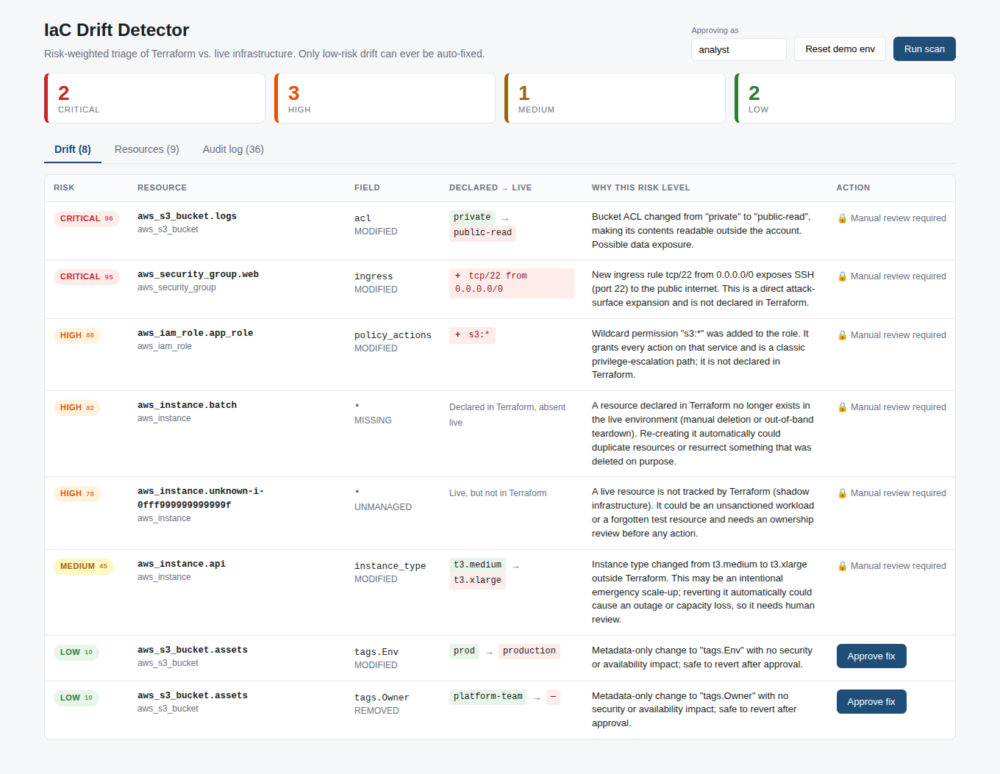

# IaC Drift Detector

Detects **configuration drift** between what Terraform says your infrastructure should look like and what is actually running in the cloud, then **triages every finding by risk** so that only provably harmless drift can ever be auto-fixed.



Most drift tools stop at "these resources differ." This one answers the harder question: *is it safe to put back?* A changed tag is. A security group suddenly open to `0.0.0.0/0` on SSH is an incident, not a diff, and an instance that was resized by hand might be an on-call engineer's emergency scale-up that a blind revert would undo.

## What it does

- **Diffs at field level**: compares Terraform state (v4 `.tfstate`) against live state per attribute (`tags.Env`, `ingress`, `acl`), not whole-object hashes. It also detects `MISSING` (declared, deleted live) and `UNMANAGED` (live, not in Terraform) resources.
- **Classifies every finding** as `LOW` / `MEDIUM` / `HIGH` / `CRITICAL` with a 0-100 score and a human-readable justification, via pluggable per-resource-type classifiers.
- **Gates remediation on risk.** Only `LOW` drift can be remediated, with a human clicking approve. The gate is enforced **server-side**: calling the API directly on a `CRITICAL` finding returns `403`, and the attempt is audit-logged.
- **Fails safe.** A field no classifier recognises is escalated as `MEDIUM`, never auto-fixed.
- **Audits everything** (scans, detections, proposals, approvals, blocked attempts) to an append-only `audit_log` table.

## Quick start (Docker)

```bash
docker compose up --build
```

Then open **http://localhost:3000** (API on http://localhost:4000/api). The backend runs one scan on first boot, so the dashboard is populated immediately.

## Run without Docker

Requires Node 20+ and PostgreSQL 16.

```bash
# 1. database
createuser -P iac            # password: iacpass
createdb -O iac iacdrift

# 2. backend  (http://localhost:4000)
cd backend
npm install
npm start                    # applies the schema automatically on startup

# 3. frontend (http://localhost:3000, proxies /api to :4000)
cd ../frontend
npm install
npm run dev
```

Override the connection with `DATABASE_URL` (see `.env.example`).

## 2-minute demo

1. Open the dashboard. 8 findings: 2 CRITICAL, 3 HIGH, 1 MEDIUM, 2 LOW.
2. Read the **"Why this risk level"** column. Each verdict explains itself.
3. Only the two `LOW` rows have an **Approve fix** button; everything else shows 🔒 *Manual review required*.
4. Click **Approve fix** on a LOW row, then **Run scan**. That finding is gone because the fix was applied to the (mock) cloud.
5. Open the **Audit log** tab to see the full trail. Optionally try to remediate a CRITICAL finding with `curl` (see `docs/RESULTS.md`) and watch it get blocked and logged.
6. **Reset demo env** puts the mock cloud back to its drifted state.

## API

| Method | Path | Purpose |
|---|---|---|
| `POST` | `/api/scans` | Run a scan; returns counts by risk level |
| `GET` | `/api/scans` | Recent scans |
| `GET` | `/api/drift[?risk=CRITICAL]` | Findings from the latest scan, worst first |
| `GET` | `/api/drift/summary` | Open findings per risk level |
| `POST` | `/api/drift/:id/remediate` | Approve a fix. `403` unless the finding is `LOW` |
| `GET` | `/api/resources` | Inventory: declared vs live state per resource |
| `GET` | `/api/audit-log?limit=` | Audit events, newest first |
| `POST` | `/api/demo/reset` | Reset the mock cloud to its drifted seed state |
| `GET` | `/api/health` | Liveness |

## Project layout

```
backend/
  data/terraform.tfstate         sample Terraform state (v4 format) = the "declared" side
  src/
    mockcloud/                   CloudStateProvider seam + mock AWS state with seeded drift
    driftengine/                 tfstate parser + field-level diff
    riskengine/
      RiskClassifier.js          base contract
      classifiers/               one file per resource type (auto-discovered)
    remediation/                 risk gate + proposed fixes
    scanService.js               scan orchestration (single DB transaction)
    api/routes.js                REST endpoints
    db/schema.sql                idempotent schema, applied on startup
  test/                          20 unit tests (node:test, no extra deps)
frontend/                        React + Vite dashboard (nginx in Docker)
docs/                            ARCHITECTURE, RESULTS, INTERVIEW_NOTES
```

## Adding support for a new resource type

Drop one file into `backend/src/riskengine/classifiers/`. It is discovered automatically; no other code changes.

```js
const RiskClassifier = require('../RiskClassifier');

class RdsRiskClassifier extends RiskClassifier {
  constructor() { super({ name: 'RdsRiskClassifier', resourceTypes: ['aws_db_instance'] }); }

  classify(drift) {
    if (drift.field === 'publicly_accessible' && drift.liveValue === true) {
      return { level: 'CRITICAL', score: 97, justification: 'Database was made publicly accessible.' };
    }
    return null; // not my field -> falls through to the generic fail-safe classifier
  }
}
module.exports = RdsRiskClassifier;
```

Every verdict is validated by the registry (valid level, 0-100 integer score, non-empty justification), so a classifier cannot return an unexplained result.

## Tests

```bash
cd backend && npm test      # 20 tests: diff engine, every classifier, remediation gate, mock provider
```

## Scope and honesty notes

- The **cloud side is a mock** (`MockCloudProvider`). There are no AWS calls and no credentials. It sits behind a small interface (`listResources`, `applyFix`, `reset`) so a real AWS/GCP/Azure provider can be dropped in without touching the diff or risk engines. That real provider is **not implemented**.
- "Remediate" changes the **mock** cloud state. It never runs `terraform apply`.
- The sample resource attributes (`acl`, `versioning`, `encryption` on the bucket, etc.) are a **simplified schema** for the demo, not the exact attribute layout of the real AWS Terraform provider.
- See `docs/ARCHITECTURE.md` for design rationale and the list of what would change for production use.
