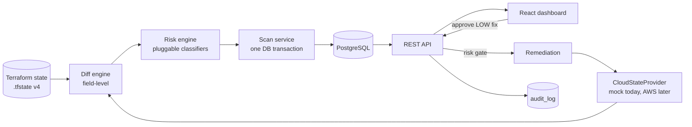
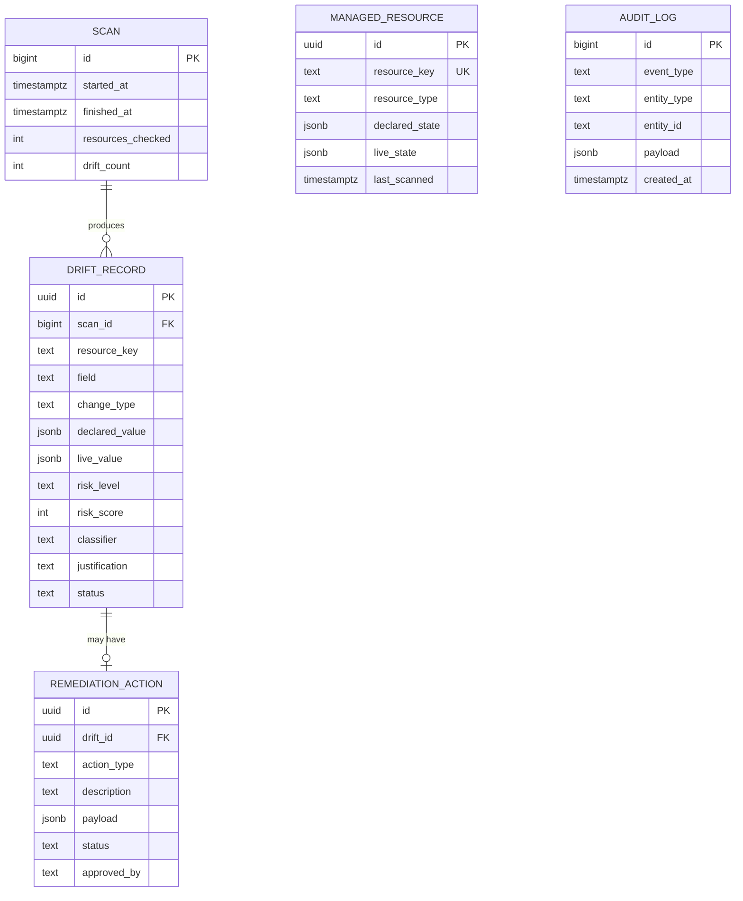

# Architecture

## 1. Overview

**Scan flow:** `POST /api/scans` loads declared state from the tfstate, reads live state from the provider, diffs them, classifies every finding, then persists findings, proposed fixes and audit events atomically in one transaction.

**Remediation flow:** the UI calls `POST /api/drift/:id/remediate`. The API re-reads the finding from the database, applies the **risk gate**, and only for `LOW` applies the revert to the provider, marks the finding `REMEDIATED`, and logs it, all in one transaction.

## 2. Components and why each exists

### Diff engine (`driftengine/`)
Compares declared vs live **per attribute**, flattening nested objects to dotted paths (`tags.Env`). Arrays (e.g. `ingress`) are compared as a unit and the classifier inspects the set difference. Field-level diffing matters because the risk engine must know *what* changed: `tags.Env` and `ingress` are very different events. It also produces readable findings. Two resource-level findings exist: `MISSING` (declared but gone) and `UNMANAGED` (live but not in Terraform).

### Risk engine (`riskengine/`) - the core idea
Strategy pattern. Each resource type has a classifier (`SecurityGroup`, `IamRole`, `S3Bucket`, `Instance`) that returns a level, score and justification, or `null` for fields it does not cover. A `GenericRiskClassifier` is the fallback.

- **Auto-discovery:** the registry loads every file in `classifiers/`. A new resource type is one new file.
- **Contract, not convention:** the registry validates each verdict (level in the enum, integer 0-100 score, non-empty justification). A plugin cannot return a bare "HIGH".
- **Fail-safe default:** the generic classifier marks only tags/description as `LOW`. Any unrecognised field becomes `MEDIUM` and is escalated, not auto-fixed. Unknown never means safe.
- Examples: SSH/RDP/DB port open to `0.0.0.0/0` → `CRITICAL`; `s3:*` added to a role → `HIGH`; instance resized → `MEDIUM` (could be an intentional emergency scale-up); tag changed → `LOW`.

### Remediation (`remediation/`)
A proposed fix (revert-to-declared) is generated **only** for `LOW` findings. `assertRemediable` is the server-side gate used by the endpoint, so hiding a button in the UI is not the control; the API is. Blocked attempts are logged as `REMEDIATION_BLOCKED`. Even `LOW` fixes require an explicit human approval and record who approved.

### Mock cloud provider (`mockcloud/`)
Implements `listResources()`, `applyFix(resourceKey, field, value)` and `reset()`. It holds in-memory state seeded with deliberate drift across every severity so the demo is deterministic and needs no credentials. A real provider implements the same three methods.

### Audit log
Append-only table written inside the same transaction as the action it describes: `SCAN_STARTED`, `DRIFT_DETECTED`, `REMEDIATION_PROPOSED`, `REMEDIATION_APPLIED`, `REMEDIATION_BLOCKED`, `SCAN_COMPLETED`, `DEMO_RESET`.

## 3. Data model

`CHECK` constraints enforce the risk-level, change-type and status enums at the database level, not just in application code. JSONB stores heterogeneous attribute values.

## 4. Key design decisions and trade-offs

| Decision | Why | Trade-off |
|---|---|---|
| Field-level diff | Risk depends on *which* field changed; findings are readable | More findings than a whole-resource diff |
| 4 risk levels, only `LOW` remediable | Anything ambiguous should reach a human | Some safe fixes still need a person |
| Gate enforced in the API | UI controls are not security controls | Slightly more code than hiding a button |
| Unknown field → `MEDIUM` | Fail-safe: new/unrecognised config is never auto-fixed | Noisier until classifiers are added |
| Classifier auto-discovery | Extensible with zero core changes | File-name-based loading is implicit magic |
| Mock provider behind an interface | Reproducible demo, no credentials | Real cloud behaviour (pagination, eventual consistency) is not exercised |
| Scan + audit in one transaction | The audit trail can never disagree with the data | Longer transaction for very large scans |
| Idempotent schema on startup | Zero-step setup | Not a substitute for real migrations at scale |

## 5. What would change for production

- **Real cloud provider** (AWS SDK), with pagination, rate-limit handling, retries, multi-account/region support.
- **Terraform state from a remote backend** (S3 + locking) rather than a local file. State can contain secrets, so access control and redaction are needed.
- **Attribute normalisation** against the real provider schema, and ignoring computed/volatile attributes so they do not show up as drift.
- **Remediate through Terraform** (`plan`/`apply`, or open a PR) rather than mutating cloud state directly, so the source of truth stays Terraform.
- **Authn/authz** (who may approve, separation of duties) and approver identity taken from the session rather than a typed name.
- **Scheduled scans**, alerting (Slack/email) for `CRITICAL`, trend analytics on repeatedly drifting resources, and proper DB migrations.
