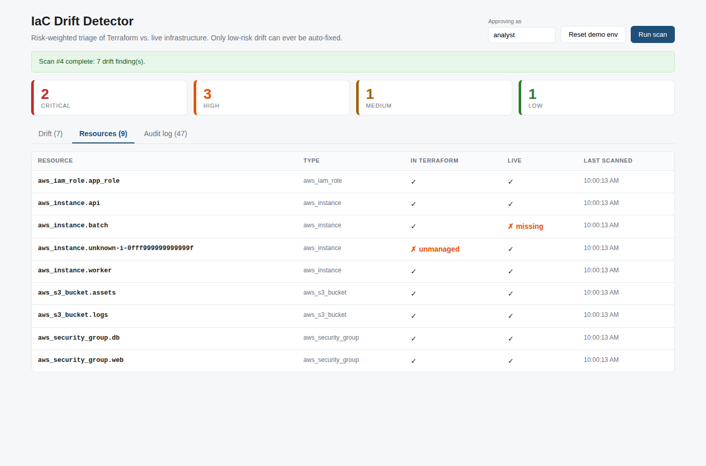
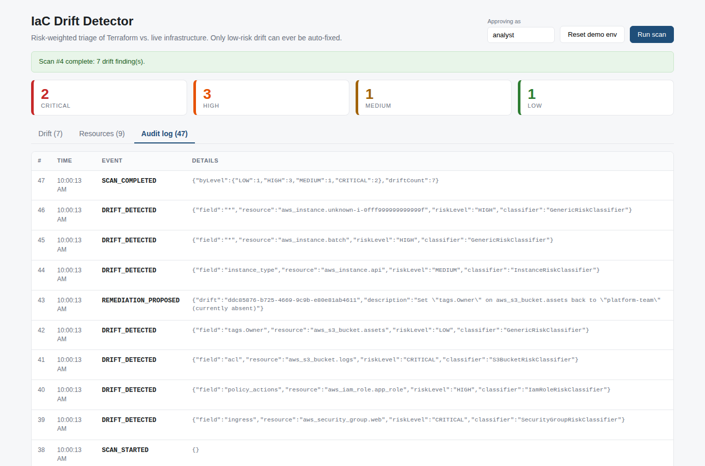

# Results

Everything below is real output from running this project, not mocked-up examples.

## Verification status

| Check | Status |
|---|---|
| Backend unit tests (`npm test`) | **20 / 20 passing** |
| Backend against a real **PostgreSQL 16** (schema, scan, remediation, audit) | **Verified** (run outside Docker) |
| Frontend production build (`npm run build`) | **Verified** |
| Dashboard driven in headless Chromium against the live API (filter, approve, rescan, tabs) | **Verified, 0 console errors** |
| `docker compose up --build` | **Not executed in the authoring environment** (no Docker available there). The Dockerfiles, nginx config and compose file are straightforward but untested. If anything fails, check them first. |

## 1. Unit tests (20 passing)

- identical state produces no drift
- nested tag changes are reported per key with dotted paths
- added field is detected
- declared resource absent live is MISSING; live-only resource is UNMANAGED
- arrays are compared as a unit and order matters
- only LOW drift passes the remediation gate
- no remediation is proposed for non-LOW findings
- LOW MODIFIED proposes SET_FIELD; LOW ADDED proposes DELETE_FIELD; REMOVED reads "absent"
- mock provider applies and deletes dotted-path fields
- setPath creates intermediate objects
- all classifiers are auto-discovered
- SSH open to the world is CRITICAL
- non-sensitive port open to the world is HIGH; new internal rule is MEDIUM
- IAM wildcard actions: service wildcard HIGH, full wildcard CRITICAL
- public S3 ACL is CRITICAL; versioning disabled is MEDIUM
- instance resize is MEDIUM (could be an intentional emergency scale-up)
- tag changes are LOW
- FAIL-SAFE: an unrecognised field is escalated (MEDIUM), never LOW
- MISSING and UNMANAGED resources are HIGH
- a verdict without a justification is rejected by the registry contract

## 2. End-to-end API run against PostgreSQL

Command sequence: scan → try to remediate a CRITICAL finding → approve the two LOW fixes → edge cases → rescan → read the audit trail.

```text
### 1. Initial scan, worst first
RISK      SCORE RESOURCE                                     FIELD            CHANGE     AUTO-FIXABLE
CRITICAL  96    aws_s3_bucket.logs                           acl              MODIFIED   no
CRITICAL  95    aws_security_group.web                       ingress          MODIFIED   no
HIGH      88    aws_iam_role.app_role                        policy_actions   MODIFIED   no
HIGH      82    aws_instance.batch                           *                MISSING    no
HIGH      78    aws_instance.unknown-i-0fff999999999999f     *                UNMANAGED  no
MEDIUM    45    aws_instance.api                             instance_type    MODIFIED   no
LOW       10    aws_s3_bucket.assets                         tags.Env         MODIFIED   yes (with approval)
LOW       10    aws_s3_bucket.assets                         tags.Owner       REMOVED    yes (with approval)

### 2. Try to remediate a CRITICAL finding by calling the API directly
{"error":"Remediation blocked: CRITICAL risk drift is never auto-remediated. Escalate for manual review. Reason: New ingress rule tcp/22 from 0.0.0.0/0 exposes SSH (port 22) to the public internet. This is a direct attack-surface expansion and is not declared in Terraform.","riskLevel":"CRITICAL"}
HTTP 403

### 3. Approve the two LOW fixes
{"status":"REMEDIATED","description":"Set \"tags.Env\" on aws_s3_bucket.assets back to \"prod\" (currently \"production\")","approvedBy":"hemanth"}
{"status":"REMEDIATED","description":"Set \"tags.Owner\" on aws_s3_bucket.assets back to \"platform-team\" (currently absent)","approvedBy":"hemanth"}

### 4. Edge cases
re-approve an already remediated drift -> {"error":"Drift is already REMEDIATED"} HTTP 409
malformed id -> {"error":"Invalid drift id"} HTTP 400

### 5. Rescan (the two LOW fixes should be gone from the live cloud)
{"scanId":2,"driftCount":6,"byLevel":{"LOW":0,"MEDIUM":1,"HIGH":3,"CRITICAL":2}}

### 6. Audit trail (remediation workflow only)
#12  SCAN_COMPLETED        {"byLevel": {"LOW": 2, "HIGH": 3, "MEDIUM": 1, "CRITICAL": 2}, "driftCount": 8}
#13  REMEDIATION_BLOCKED   {"field": "ingress", "resource": "aws_security_group.web", "riskLevel": "CRITICAL", "attemptedBy": "hemanth"}
#14  REMEDIATION_APPLIED   {"drift": "6288ba6a-3b92-412c-a1d8-014fc1a9cd32", "approvedBy": "hemanth", "description": "Set \"tags.Env\" on aws_s3_bu
#15  REMEDIATION_APPLIED   {"drift": "4d6c5b93-ccd7-404b-abb4-4a99583e758b", "approvedBy": "hemanth", "description": "Set \"tags.Owner\" on aws_s3_
#23  SCAN_COMPLETED        {"byLevel": {"LOW": 0, "HIGH": 3, "MEDIUM": 1, "CRITICAL": 2}, "driftCount": 6}
```

### What this shows

- **8 findings** from a seeded environment, ranked by risk, with only the two `LOW` tag findings eligible for a fix.
- **The safety gate is real.** Calling `POST /api/drift/:id/remediate` directly on the CRITICAL SSH finding returns **HTTP 403** with the justification, even though the caller supplied an approver name. Nothing was changed.
- **Approved LOW fixes actually apply.** After approval and a rescan the finding count drops from 8 to 6 and the `LOW` count goes to 0.
- **Edge cases:** re-approving → `409`; malformed id → `400`.
- **Audit trail** records the blocked CRITICAL attempt (`#13`) and both approved fixes (`#14`, `#15`) with who approved them.

## 3. Dashboard


Resource inventory (declared vs live):



Audit log:



## 4. Known limitations

- **Mock cloud only.** No real AWS calls. Remediation changes in-memory mock state, not real infrastructure and not Terraform.
- **Simplified attribute schema.** Resource attributes are a demo model, not the real AWS provider schema.
- **Approval race.** The remediate endpoint reads the finding's status before opening its transaction and does not take a row lock, so two simultaneous approvals of the same finding could both pass the check. The effect here is a duplicate audit entry (the fix itself is idempotent). The fix is `SELECT ... FOR UPDATE` inside the transaction.
- **Approver is self-declared.** The name comes from a text box; there is no authentication.
- **Only the latest scan is shown** in the drift view; scan history is stored but not browsable in the UI.
- **Classifier coverage is small** (security group, IAM role, S3 bucket, EC2 instance + generic fallback). Unrecognised fields are escalated rather than guessed, by design.
